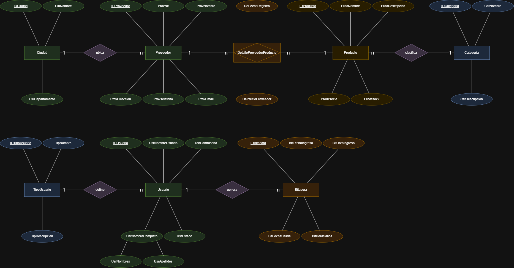

# Gestión de Proveedores y Productos — Proyecto Final de Bases de Datos I

<p align="center">
  
  
  
  
  
  
  
</p>

<p align="center">
  Aplicación de escritorio para gestionar proveedores, productos, categorías y usuarios sobre SQL Server — con SQL escrito a mano, roles de acceso, bitácora de ingresos, consultas con JOIN y subconsultas, y reportes filtrables exportables a PDF.
</p>

---

## Descripción

El sistema permite llevar el control de **qué proveedor ofrece cada producto, en qué ciudad está y a qué precio**, con tres tipos de usuario y un registro de auditoría de cada ingreso y salida. No usa ningún framework de persistencia: toda la comunicación con la base de datos es **SQL propio con `pyodbc`**, y la interfaz se construye con **Qt Designer** (PySide6).

```
view  ──►  service  ──►  dao  ──►  SQL Server
 └──────── DTO (model) viaja entre las capas ────────┘
```

---

## Funcionalidades

- **Ingreso y sesión** — login con contraseñas guardadas como hash SHA-256; cada ingreso y salida queda registrado en la bitácora con fecha y hora
- **Gestión de entidades** — ciudades, categorías, productos y proveedores con CRUD completo, validaciones (NIT único, precios mayores que cero) y mensajes claros cuando un borrado lo impide una llave foránea
- **Transacciones** — relación proveedor–producto (N:M) con precio de cada proveedor y fecha de registro
- **Consultas** — 5 consultas listas para usar: 3 con JOIN de varias tablas y 2 con subconsulta
- **Reportes** — 5 reportes con filtros elegidos por el usuario, visibles en tabla y exportables a PDF
- **Auditoría** — gestión de usuarios (solo el Administrador) y consulta de la bitácora de entradas y salidas
- **Roles y permisos** — Administrador, Tradicional y Esporádico, almacenados en la base de datos
- **Interfaz propia** — tema visual fijo (no depende del tema de Windows) y menú principal por tarjetas, además de la barra de menú clásica
- **Tolerancia a fallos** — si SQL Server no responde, la aplicación lo avisa con un mensaje claro en vez de cerrarse

---

## Roles y permisos

| Rol | Entidades y Transacciones | Consultas y Reportes | Auditoría |
|-----|:-------------------------:|:--------------------:|:---------:|
| **Administrador** | ✅ | ✅ (las 5 consultas) | ✅ |
| **Tradicional** | ✅ | ✅ (4 consultas) | — |
| **Esporádico** | — | ✅ (4 consultas) | — |

- Existe **un único Administrador**: no se puede eliminar, desactivar ni cambiar de rol, y no se puede crear un segundo.
- Solo el Administrador crea, edita y desactiva usuarios.
- Los usuarios **no se borran**: se desactivan (borrado lógico) para conservar su historial en la bitácora.
- La consulta de la bitácora solo la ve el Administrador.

---

## Arquitectura

Arquitectura por capas con una responsabilidad por carpeta. La vista nunca escribe SQL y el DAO nunca sabe que existe una ventana.

| Capa | Ubicación | Responsabilidad |
|------|-----------|-----------------|
| **DTO** | `model/` | Una clase por tabla, solo atributos: viaja entre capas sin lógica ni SQL |
| **DAO** | `dao/` | Único lugar con SQL. Una clase por tabla (agregar, consultar, editar, eliminar) más `ConsultasDAO` y `ReportesDAO`. Consultas siempre parametrizadas (`?`) |
| **Service** | `service/` | Reglas de negocio: login, permisos por rol, único Administrador, hash de contraseñas y generación de PDF |
| **View** | `view/` | Ventanas diseñadas en Qt Designer (`.ui`); cada ventana hereda de la UI generada y agrega el comportamiento |
| **Tema** | `view/tema.qss` | Hoja de estilos de toda la aplicación |

---

## Modelo de datos

<p align="center">
  
  <br/>
  <sub>Diagrama entidad-relación (notación de Chen)</sub>
</p>

<p align="center">
  
  <br/>
  <sub>Diagrama relacional</sub>
</p>

| Tabla | Llave primaria | Llaves foráneas | Relación |
|-------|----------------|-----------------|----------|
| `Ciudad` | `IDCiudad` | — | 1 ciudad → N proveedores |
| `Categoria` | `IDCategoria` | — | 1 categoría → N productos |
| `Proveedor` | `IDProveedor` | `IDCiudad` | N:M con `Producto` |
| `Producto` | `IDProducto` | `IDCategoria` | N:M con `Proveedor` |
| `DetalleProveedorProducto` | `IDProveedor` + `IDProducto` | ambas | Resuelve la N:M; guarda precio del proveedor y fecha |
| `TipoUsuario` | `IDTipoUsuario` | — | 1 rol → N usuarios |
| `Usuario` | `IDUsuario` | `IDTipoUsuario` | 1 usuario → N registros de bitácora |
| `Bitacora` | `IDBitacora` | `IDUsuario` | Ingreso y salida de cada sesión |

El detalle de cada columna (tipo, nulabilidad y llaves) está en [`docs/DiccionarioDatos.md`](docs/DiccionarioDatos.md).

---

## Normalización

El modelo relacional está en **tercera forma normal (3FN)** y, como todos los determinantes son llaves candidatas, también cumple la **forma normal de Boyce-Codd (BCNF)**.

| Forma normal | Qué exige | Cómo se cumple |
|--------------|-----------|----------------|
| **1FN** | Valores atómicos, sin grupos repetidos | Ninguna columna guarda listas. El nombre de la persona se separa en `UsrNombres` y `UsrApellidos`; fecha y hora de la bitácora van en columnas distintas |
| **2FN** | Ningún atributo depende de solo una parte de una llave compuesta | La única llave compuesta es la de `DetalleProveedorProducto`; su fecha y su precio dependen del par proveedor–producto completo. Las demás tablas tienen llave de una sola columna |
| **3FN** | Ningún atributo no llave depende de otro atributo no llave | Los datos que dependen de otra entidad viven en su propia tabla y se referencian por llave foránea: ciudad, categoría y tipo de usuario |
| **BCNF** | Todo determinante es una llave candidata | Los únicos determinantes que no son la llave primaria (`ProvNit`, `UsrNombreUsuario`, `TipNombre`) tienen restricción `UNIQUE` |

### Decisiones que llevaron al modelo

| Si no se hiciera así... | Se resolvió con... | Forma normal |
|-------------------------|--------------------|:------------:|
| El nombre completo en una sola columna dificulta buscar y ordenar por apellido | `UsrNombres` + `UsrApellidos` | 1FN |
| Un proveedor con varios productos (y un producto con varios proveedores) obligaría a repetir filas o guardar listas | Tabla intermedia `DetalleProveedorProducto` con llave compuesta | 1FN |
| El precio de un proveedor no pertenece al proveedor ni al producto por separado, sino a la pareja | `DePrecioProveedor` y `DeFechaRegistro` en la tabla intermedia | 2FN |
| La ciudad y el departamento se repetirían en cada proveedor | Tabla `Ciudad` referenciada por `Proveedor.IDCiudad` | 3FN |
| El nombre de la categoría se repetiría en cada producto | Tabla `Categoria` referenciada por `Producto.IDCategoria` | 3FN |
| El rol escrito como texto en cada usuario admite variantes y errores ("Admin", "administrador"...) | Tabla `TipoUsuario` referenciada por `Usuario.IDTipoUsuario` | 3FN |

<details>
<summary><strong>Dependencias funcionales por tabla</strong></summary>

| Tabla | Dependencias funcionales | Llaves candidatas |
|-------|--------------------------|-------------------|
| `Ciudad` | `IDCiudad` → `CiuNombre`, `CiuDepartamento` | `IDCiudad` |
| `Categoria` | `IDCategoria` → `CatNombre`, `CatDescripcion` | `IDCategoria` |
| `TipoUsuario` | `IDTipoUsuario` → `TipNombre`, `TipDescripcion` <br> `TipNombre` → `IDTipoUsuario`, `TipDescripcion` | `IDTipoUsuario`, `TipNombre` |
| `Proveedor` | `IDProveedor` → `ProvNit`, `ProvNombre`, `ProvDireccion`, `ProvTelefono`, `ProvEmail`, `IDCiudad` <br> `ProvNit` → `IDProveedor`, `ProvNombre`, `ProvDireccion`, `ProvTelefono`, `ProvEmail`, `IDCiudad` | `IDProveedor`, `ProvNit` |
| `Producto` | `IDProducto` → `ProdNombre`, `ProdDescripcion`, `ProdPrecio`, `ProdStock`, `IDCategoria` | `IDProducto` |
| `DetalleProveedorProducto` | (`IDProveedor`, `IDProducto`) → `DeFechaRegistro`, `DePrecioProveedor` | (`IDProveedor`, `IDProducto`) |
| `Usuario` | `IDUsuario` → `UsrNombreUsuario`, `UsrContrasena`, `UsrNombres`, `UsrApellidos`, `UsrEstado`, `IDTipoUsuario` <br> `UsrNombreUsuario` → `IDUsuario`, `UsrContrasena`, `UsrNombres`, `UsrApellidos`, `UsrEstado`, `IDTipoUsuario` | `IDUsuario`, `UsrNombreUsuario` |
| `Bitacora` | `IDBitacora` → `IDUsuario`, `BitFechaIngreso`, `BitHoraIngreso`, `BitFechaSalida`, `BitHoraSalida` | `IDBitacora` |

En ninguna tabla un atributo que no es llave determina a otro, y en todas el lado izquierdo de cada dependencia es una llave candidata, por lo que no hay dependencias parciales ni transitivas.

</details>

<details>
<summary><strong>Observaciones del diseño</strong></summary>

- **`CiuDepartamento` se repite como texto** en las ciudades del mismo departamento. No viola la 3FN, porque el nombre de la ciudad no determina el departamento (hay ciudades con el mismo nombre en departamentos distintos). Si se quisiera eliminar esa repetición, se crearía una tabla `Departamento`; se dejó fuera para mantener el modelo simple.
- **`ProdPrecio` y `DePrecioProveedor` no son redundantes:** el primero es el precio de venta del producto y el segundo lo que cobra cada proveedor por él.
- **Un teléfono y un correo por proveedor.** Si se necesitaran varios, cada uno pasaría a su propia tabla para conservar la 1FN.
- **Los permisos de cada rol** se validan en el código y no en tablas (`Permiso`, `TipoUsuarioPermiso`), una decisión de alcance que no afecta la normalización.

</details>

---

## Tecnologías

- **Python 3.11+** — lenguaje principal
- **PySide6** — interfaz gráfica; ventanas diseñadas con **Qt Designer**
- **SQL Server** — motor de base de datos
- **pyodbc** — conexión a SQL Server con SQL escrito a mano (**sin ORM**)
- **ReportLab** — generación de reportes en PDF
- **QSS** — hoja de estilos de Qt para el tema visual

---

## Estructura del proyecto

```
ProyectoFinal/
├── main.py                       # Punto de entrada de la aplicación
├── probar_conexion.py            # Verifica la conexión con SQL Server
├── requirements.txt
├── db/
│   ├── 01_crear_tablas.sql       # Crea la base de datos y las 8 tablas
│   └── 02_datos_iniciales.sql    # Roles, usuario Administrador y datos de prueba
├── docs/                         # Diccionario de datos y diagramas
├── model/                        # DTOs: Ciudad, Categoria, Proveedor, Producto,
│                                 #       DetalleProveedorProducto, TipoUsuario,
│                                 #       Usuario, Bitacora
├── dao/                          # Acceso a datos (único lugar con SQL)
│   ├── Conexion.py               # Abre la conexión con pyodbc
│   ├── *DAO.py                   # Un DAO por tabla
│   ├── ConsultasDAO.py           # Consultas con JOIN y subconsultas
│   └── ReportesDAO.py            # Reportes con filtros
├── service/
│   ├── UsuarioService.py         # Login, permisos y gestión de usuarios
│   ├── Sesion.py                 # Usuario, rol y bitácora de la sesión actual
│   └── ReportePdfService.py      # Exportación de reportes a PDF
└── view/
    ├── tema.qss / tema.py        # Tema visual
    ├── recursos/                 # Íconos SVG del tema
    ├── ingreso/                  # Login
    ├── menu_principal/           # Menú principal con tarjetas
    ├── entidades/                # Ciudad, Categoría, Producto, Proveedor
    ├── transacciones/            # Relación Proveedor–Producto
    ├── consultas_reportes/       # Consultas y Reportes
    └── auditoria/                # Gestión de usuarios y Bitácora
                                  # (cada ventana: .ui de Qt Designer + ui_*.py generado + clase de la ventana)
```

---

## Instalación y ejecución

**Requisitos:** Python 3.11+, SQL Server (Express o Developer) con autenticación mixta y el usuario `sa` habilitado, y **ODBC Driver 17 o 18 for SQL Server**.

### 1. Entorno virtual y dependencias

```powershell
python -m venv venv
venv\Scripts\Activate.ps1
pip install -r requirements.txt
```

### 2. Base de datos

Ejecuta los dos scripts **en orden** desde la raíz del proyecto (también puedes abrirlos en SSMS):

```powershell
sqlcmd -S localhost -U sa -P "TU_CONTRASENA" -C -i db\01_crear_tablas.sql
sqlcmd -S localhost -U sa -P "TU_CONTRASENA" -C -i db\02_datos_iniciales.sql
```

Esto crea la base `ProyectoFinalBD`, las 8 tablas, los 3 roles, el usuario Administrador y unos datos de prueba.

### 3. Conexión

Crea el archivo `dao/config_local.py` con los datos de **tu** instancia. Cada integrante tiene el suyo y no se sube al repositorio:

```python
DRIVER = "ODBC Driver 18 for SQL Server"
SERVIDOR = "localhost"
BASE_DATOS = "ProyectoFinalBD"
USUARIO = "sa"
CONTRASENA = "tu_contrasena"
```

Puedes ver los drivers instalados con `python -c "import pyodbc; print(pyodbc.drivers())"`. Para comprobar que todo conecta:

```powershell
python probar_conexion.py
```

Debe imprimir los 3 roles: Administrador, Tradicional y Esporadico.

### 4. Ejecutar

```powershell
python main.py
```

**Primer ingreso:** usuario `admin` · contraseña `Admin123`.

> Si editas un `.ui` en Qt Designer, regenera su clase con `pyside6-uic archivo.ui -o ui_archivo.py`.

---

## Módulos de la aplicación

<details>
<summary><strong>Entidades</strong></summary>

| Ventana | Qué permite | Reglas |
|---------|-------------|--------|
| Ciudades | Registrar ciudad y departamento | No se elimina una ciudad con proveedores |
| Categorías | Nombre y descripción (opcional) | No se elimina una categoría con productos |
| Productos | Precio, stock y categoría (lista desplegable) | Precio mayor que cero |
| Proveedores | NIT, contacto y ciudad (lista desplegable); email opcional | NIT único |

</details>

<details>
<summary><strong>Transacciones</strong></summary>

| Ventana | Qué permite | Reglas |
|---------|-------------|--------|
| Proveedor – Producto | Registrar qué proveedor ofrece cada producto, con fecha y precio | Una relación por pareja; el mismo producto puede tener varios proveedores. Al editar solo cambian fecha y precio |

</details>

<details>
<summary><strong>Consultas</strong></summary>

| Consulta | Tipo | Tablas |
|----------|------|--------|
| Proveedores con su ciudad y productos | JOIN | Proveedor, Ciudad, DetalleProveedorProducto, Producto |
| Productos con su categoría y proveedores | JOIN | Producto, Categoria, DetalleProveedorProducto, Proveedor |
| Bitácora con usuario y rol *(solo Administrador)* | JOIN | Bitacora, Usuario, TipoUsuario |
| Proveedores sin productos | Subconsulta (`NOT IN`) | Proveedor, DetalleProveedorProducto |
| Categorías con su cantidad de productos | Subconsulta correlacionada | Categoria, Producto |

</details>

<details>
<summary><strong>Reportes</strong></summary>

| Reporte | Filtros |
|---------|---------|
| Productos de un proveedor | Proveedor |
| Proveedores de una ciudad | Ciudad |
| Proveedores de un producto por rango de precio | Producto, precio mínimo y máximo (extremos incluidos) |
| Productos de una categoría | Categoría |
| Productos con stock bajo por categoría | Categoría, stock máximo |

Cada reporte se muestra en una tabla y se exporta a un PDF horizontal con el título, los filtros aplicados, quién lo generó y cuándo, y el total de registros.

</details>

<details>
<summary><strong>Auditoría</strong> <em>(solo Administrador)</em></summary>

| Ventana | Qué permite |
|---------|-------------|
| Gestión de usuarios | Crear, editar y desactivar usuarios; asignar rol; cambiar la contraseña (vacía conserva la actual) |
| Bitácora | Ver cada ingreso y salida con usuario, rol, fecha y hora; una sesión abierta aparece con la salida en blanco |

</details>

---

## Autores

| Nombre | GitHub |
|--------|--------|
| Santiago Ramirez Bernal | https://github.com/SantiagoRB17 |
| Samuel Saith Calle Santa | https://github.com/Samuelk64 |
| Juan David Castañeda | https://github.com/juanda724 |

---

<p align="center">
  <sub>Bases de Datos I — Universidad del Quindío · 2026-2</sub>
</p>
